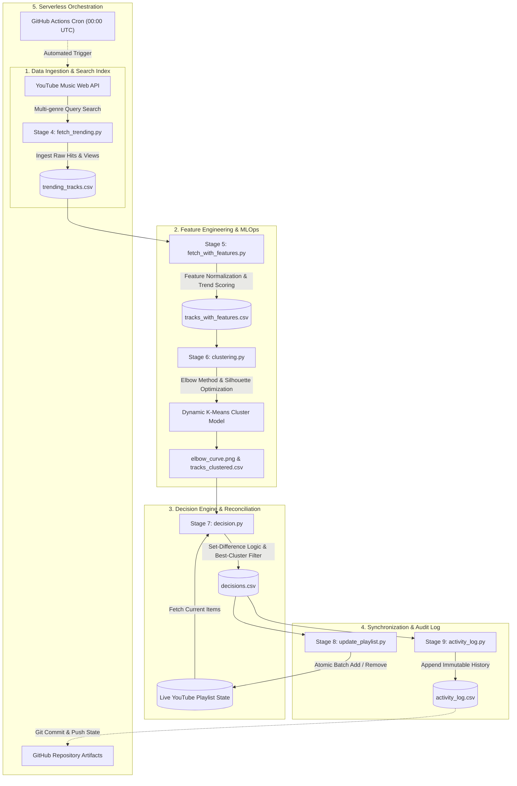

<div align="center">

# 🎵 PLAYLIVE (playlist-a-live)

### *Autonomous MLOps Pipeline for Real-Time Music Trend Intelligence & Dynamic Playlist Synthesis*

[](https://python.org)
[](https://scikit-learn.org)
[](https://music.youtube.com)
[](https://github.com/features/actions)
[](https://opensource.org/licenses/MIT)

[🎧 Listen to the Live Playlist](https://music.youtube.com/playlist?list=PLQZ2bR5J0yDY) • [📊 View Architecture](#-system-architecture) • [🤖 ML Pipeline](#-machine-learning--decision-engine) • [🚀 Quickstart](#-getting-started)

</div>

---

## 📌 Executive Overview

**PLAYLIVE** is an automated, self-healing data engineering and machine learning pipeline that continuously monitors music trend dynamics across global streaming indexes and synthesizes an optimal, self-updating 50-track playlist on YouTube Music without requiring human intervention.

Rather than relying on naive chronological updates, **PLAYLIVE** treats music trend synthesis as an **unsupervised clustering and decision optimization problem**:
1. Ingests high-velocity streaming data across diverse search genres.
2. Extracts numerical feature vectors (logarithmic engagement scoring, rank velocity, duration, and explicit constraints).
3. Evaluates cluster quality dynamically across $K \in [2, 8]$ using **Elbow Method (Inertia)** and **Silhouette Coefficient Analysis**.
4. Dispatches an autonomous set-difference decision engine that reconciles the live playlist state against the mathematically highest-density trend cluster.
5. Commits immutable daily audit logs and visual metrics back to GitHub via continuous serverless CI/CD.

---

## 🏗 System Architecture



---

## 🤖 Machine Learning & Decision Engine

### 1. Non-linear Feature Extraction
Raw streaming view counts exhibit high positive skewness. We project engagement into an engineered 0–100 popularity index using logarithmic scaling:

$$\text{Popularity Score} = \min\left(100, \max\left(30, \lfloor 20 + 8 \cdot \log_{10}(\text{Views}) \rfloor\right)\right)$$

Additional normalized features:
- **Rank Score**: Relative positional rank within query results ($\text{Rank Score} = 1 - \frac{\text{Rank}}{50}$)
- **Trend Composite Score**: Multi-objective weighted rank:
  $$\text{Trend Score} = (0.4 \times \text{Rank Score}) + (0.6 \times \text{Popularity Score})$$
- **Categorical Tiering**: Explicit tagging, duration scaling, and popularity tier thresholds.

### 2. Unsupervised K-Means with Silhouette Optimization
Rather than hardcoding an arbitrary number of clusters ($K$), the model dynamically calculates inertia and silhouette coefficients across $K \in [2, 8]$ on standardized feature vectors:

```python
scaler = StandardScaler()
X_scaled = scaler.fit_transform(X)

for k in range(2, 9):
    km = KMeans(n_clusters=k, random_state=42, n_init=10)
    labels = km.fit_predict(X_scaled)
    score = silhouette_score(X_scaled, labels)
```

The cluster with the highest mean popularity density is dynamically selected as the **Alpha Cluster** for playlist composition.

### 3. State Reconciliation Logic
Playlist state reconciliation operates via set theory:
- **Set $\mathcal{P}$**: Tracks currently present in the live playlist.
- **Set $\mathcal{T}$**: Tracks identified as actively trending.
- **Set $\mathcal{C}_{\text{best}}$**: Candidates from the optimal mathematical cluster.

$$\text{Removals} = \mathcal{P} \setminus \mathcal{T}$$
$$\text{Additions} = \text{Top}_{N}\left(\mathcal{C}_{\text{best}} \setminus \mathcal{P}\right), \quad \text{where } N = 50 - |\mathcal{P} \setminus \text{Removals}|$$

---

## 📂 Project Structure

```
playlist-a-live/
├── .github/
│   └── workflows/
│       └── daily.yml          # GitHub Actions 24-hour cron orchestration
├── activity_log.py            # Stage 9: Persistent audit trail logging
├── clustering.py              # Stage 6: K-Means & Silhouette evaluation
├── decision.py                # Stage 7: Set-difference reconciliation engine
├── fetch_trending.py          # Stage 4: High-throughput streaming search
├── fetch_with_features.py     # Stage 5: Feature scaling & normalization
├── run_pipeline.py            # Master pipeline runner
├── update_playlist.py         # Stage 8: Idempotent playlist modifier
├── yt_auth.py                 # Interactive browser credential helper
│
├── activity_log.csv           # Immutable append-only audit trail
├── decisions.csv              # Staged decisions for current execution
├── elbow_curve.png            # Generated K-Means inertia plot
├── tracks_clustered.csv       # Clustered dataset with assigned labels
├── tracks_with_features.csv   # Normalized multi-feature dataset
└── trending_tracks.csv        # Top raw trending songs
```

---

## ⚡ Tech Stack & Highlights

| Domain | Technologies Used |
|---|---|
| **Language & Core** | Python 3.11+, Standard Library |
| **Data Processing & ML** | `pandas`, `scikit-learn`, `numpy`, `matplotlib` |
| **API & Automation** | `ytmusicapi`, `requests`, Reverse-Engineered Session Signatures |
| **Orchestration & DevOps**| GitHub Actions CI/CD (Serverless Cron, Headless Secret Injection) |
| **Storage & State** | Versioned CSV State Machine & Persistent Audit Logs |

### Engineering Highlights:
- **Zero Cost / Zero Quota Limits**: Migrated from restrictive, paid-tier APIs to a zero-cost headless YouTube Music backend without requiring developer quotas or paid premium subscriptions.
- **Strict Cryptographic Security**: Session cookies and tokens are handled via `browser.json` (strictly ignored by `.gitignore`) and injected securely in CI via GitHub Encrypted Secrets.
- **Headless Execution**: Completely self-contained; runs in isolated Ubuntu container environments on GitHub runners.

---

## 🚀 Getting Started

### Prerequisites
- Python 3.10+
- A Google/YouTube account

### 1. Clone & Setup Environment
```bash
git clone https://github.com/5avis/playlist-a-live.git
cd playlist-a-live

python3 -m venv .venv
source .venv/bin/activate
pip install ytmusicapi pandas scikit-learn matplotlib requests
```

### 2. Configure Authentication
Generate your `browser.json` session token:
```bash
python yt_auth.py
```
*(Copy your request headers from [music.youtube.com](https://music.youtube.com) DevTools Network tab as instructed).*

### 3. Run Pipeline Locally
Execute all stages sequentially:
```bash
python run_pipeline.py
```

```text
🚀 PLAYLIVE Pipeline Starting (YouTube Music)...

▶️  Running Stage 4 — Fetch Trending...
✅ Stage 4 — Fetch Trending done!

▶️  Running Stage 5 — Feature Engineer...
✅ Stage 5 — Feature Engineer done!

▶️  Running Stage 6 — Clustering...
✅ Stage 6 — Clustering done!

▶️  Running Stage 7 — Decisions...
✅ Stage 7 — Decisions done!

▶️  Running Stage 8 — Update Playlist...
✅ Stage 8 — Update Playlist done!

▶️  Running Stage 9 — Activity Log...
✅ Stage 9 — Activity Log done!

🎉 Pipeline completed successfully!
```

---

## 🔄 GitHub Actions Automation

The repository includes a production-grade workflow in `.github/workflows/daily.yml` scheduled to execute daily at `00:00 UTC`:

1. Spins up an ephemeral `ubuntu-latest` runner.
2. Hydrates `browser.json` from encrypted secrets.
3. Executes `run_pipeline.py`.
4. Commits and pushes the updated dataset and audit logs (`activity_log.csv`, `elbow_curve.png`) back to the branch with zero human intervention.

---

## 📜 License
Distributed under the **MIT License**. See `LICENSE` for more information.

<div align="center">
  <sub>Built with ❤️ by <a href="https://github.com/5avis">Siva</a></sub>
</div>
